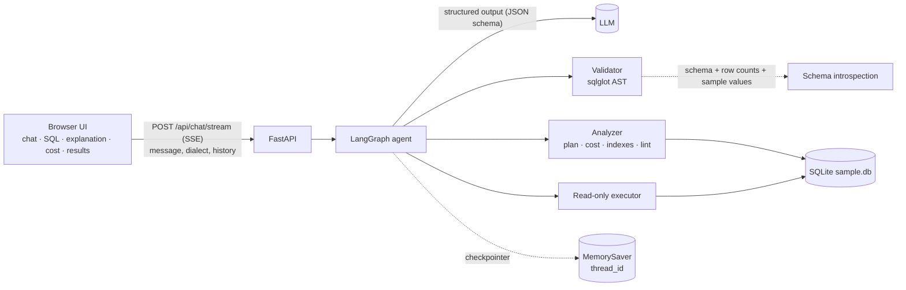
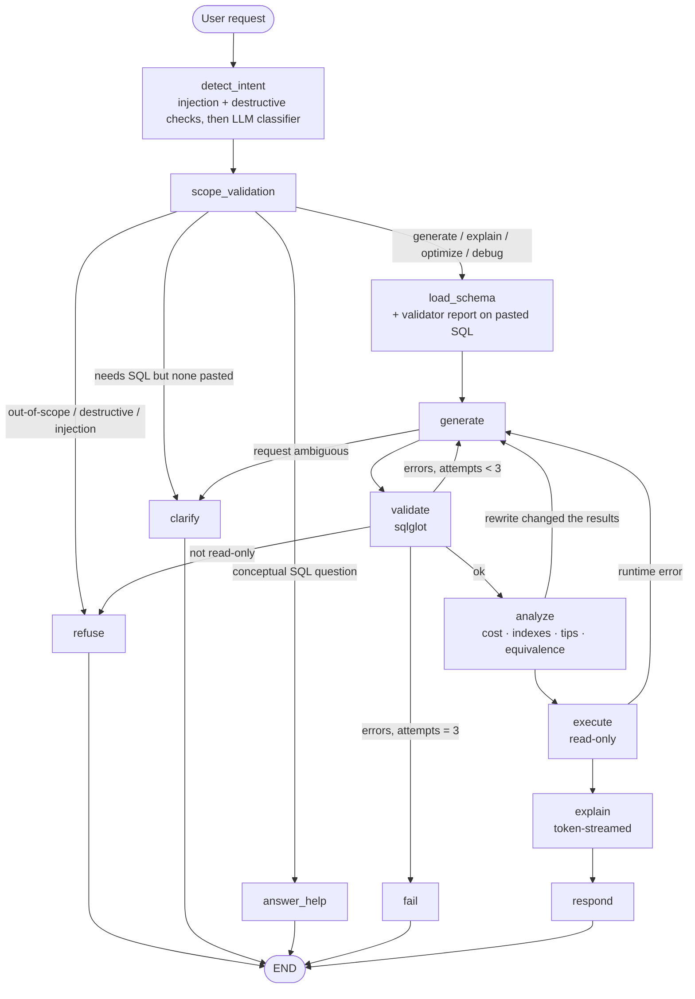
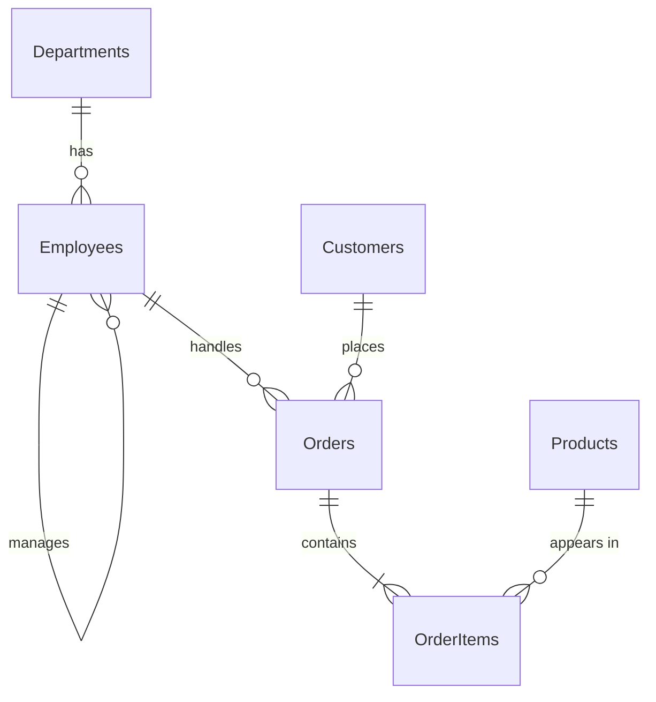

# SQL Query AI Agent

A task-focused AI agent that turns natural language into **validated, read-only SQL**, explains it in
plain English, estimates its cost, optimizes and debugs SQL you paste in, remembers conversation context,
and refuses everything that is not SQL / database related.

- **Live demo:** `https://sql-query-agent-uo0t.onrender.com` (no login needed; the sample database is pre-loaded)
- **Demo video:** `<PASTE VIDEO LINK HERE>`
- **Stack:** LangGraph · FastAPI · SQLite · sqlglot · vanilla-JS frontend (no build step) · Docker

## Features

| Requirement | Where |
|---|---|
| NL → SQL, grounded in the schema (incl. real column values, e.g. "California" → `State = 'CA'`) | `generate` node · `app/schema_utils.py` |
| Validation: tables, columns, **joins**, syntax, read-only | `app/validator.py` (sqlglot, **code, not prompt**) |
| Plain-English explanation (streamed token by token) | `explain` node |
| Optimization: readability, performance, indexes, unnecessary joins | `generate` (optimize mode) + `analyze` node (`app/analyzer.py`) |
| Debugging: identify, explain why, corrected query | `generate` (debug mode), grounded by the validator's report |
| Conversation context / follow-ups | LangGraph `MemorySaver` + persisted `last_sql` + client history replay |
| Out-of-scope refusal | `detect_intent` + `scope_validation` nodes |
| Destructive-SQL refusal | input regex (SQL *and* plain English) **and** AST validator **and** read-only DB connection |
| Conceptual SQL/DB questions ("what is a foreign key?", "what tables exist?") | `sql_help` intent → `answer_help` node |
| **Bonus:** execution on sample DB | `execute` node (read-only URI, `query_only`, 100-row cap, 5 s timeout) |
| **Bonus:** query cost estimation | `analyze` node: `EXPLAIN QUERY PLAN` + table row counts → low / medium / high |
| **Bonus:** multiple dialects (SQLite, PostgreSQL, MySQL) | per-request selector; validated in the chosen dialect; non-SQLite queries previewed via SQL transpilation |
| **Bonus:** prompt-injection protection | Unicode-normalised pattern checks, delimited data in prompts, validator as final authority |
| **Bonus:** syntax highlighting · CSV export · SQL download · dark mode · streaming | `static/index.html` |
| **Bonus:** Docker · unit + integration tests · accuracy eval | `Dockerfile` · `tests/` · `eval/` |

## Architecture



## LangGraph workflow

The graph follows the workflow in the brief (intent → scope → schema → generate → validate → optimize →
execute → explain → respond) and adds self-correction loops. An auto-generated copy lives in
[`docs/workflow.mmd`](docs/workflow.mmd) (a test fails if it drifts from the code).



**Node responsibilities**

1. **detect_intent**: Unicode-normalises the text, then runs cheap code checks (prompt-injection phrases,
   destructive requests in SQL *or* plain English such as "delete all employees"), and only then an LLM
   classifier: `generate | explain | optimize | debug | sql_help | destructive | out_of_scope`.
2. **scope_validation**: the gate into the SQL pipeline. Refusals go to `refuse`; "optimize/explain/debug"
   without any SQL pasted goes to `clarify`; conceptual questions go to `answer_help`.
3. **load_schema**: schema text (tables, columns, PKs, FKs, row counts, enum values, date ranges) read from the live
   database. For pasted SQL it also runs the validator and hands the report to the model as ground truth. A broken
   query sent to "explain"/"optimize" is automatically switched to "debug".
4. **generate**: one node, four task modes. Receives the schema, today's date, the dialect, the last 6 messages and
   the previous SQL, so follow-ups *modify* the prior query. On retries it also receives the failed SQL and the
   exact error. May return a `clarification` question instead of SQL for vague requests.
5. **validate**: the hard guardrail (see below). Failure loops back to `generate` (max 3 attempts). A
   non-read-only statement is never retried: it goes straight to a polite refusal.
6. **analyze** (the brief's *SQL Optimization* step): `EXPLAIN QUERY PLAN` cost estimate, index advice derived from
   the query's own predicates, deterministic lint tips, and LLM-suggested indexes checked against the real schema
   (hallucinated ones are dropped). In optimize mode it also **runs the original and the rewrite and compares the
   rows**; if they differ the model is sent back to fix it.
7. **execute**: read-only run on the sample DB. A runtime error is fed back to `generate` for self-correction.
   PostgreSQL / MySQL queries are transpiled to SQLite for a clearly labelled preview.
8. **explain → respond**: plain-English summary (streamed); response and `last_sql` saved to state.

**Memory:** `MemorySaver` keyed by `thread_id` (one per chat in the UI). `last_sql` persists between turns; per-turn
fields are reset in `detect_intent`. Because memory lives in process, the browser also sends its last few turns; if the
server has no state for that thread (restart / free-tier sleep) it replays them, and re-validates any replayed SQL
before trusting it.

## Guardrails (defence in depth)

1. **Input checks (no LLM call):** text is NFKC-normalised and stripped of zero-width characters, then screened for
   destructive requests (`DELETE FROM`, `drop the Orders table`, `wipe the customers table`, ...) and injection phrases
   (including attempts to close the `<user_request>` tags).
2. **LLM scope classifier:** only SQL / schema questions pass.
3. **Prompts:** user text is wrapped in tags and declared to be data, not instructions.
4. **Validator (never trusts the LLM):** exactly one statement; root must be SELECT/UNION/CTE; no
   INSERT/UPDATE/DELETE/DROP/ALTER/CREATE/TRUNCATE/PRAGMA/ATTACH/INTO/etc. anywhere in the AST; unknown tables
   (with "did you mean") and unknown/ambiguous columns rejected; **every join must follow a declared foreign key and
   have a real condition** (an error that triggers a retry, not a warning). Works in SQLite, PostgreSQL and MySQL syntax.
5. **Output checks:** the destructive-statement filter also screens free-text answers; index suggestions are parsed and
   verified against the schema, and are advice only (never executed).
6. **Database:** connection opened `mode=ro` with `PRAGMA query_only=ON`, row cap and timeout.
7. **API:** input length limit, `thread_id` format check, per-IP rate limit, generic error messages.

If the model produces destructive SQL despite all of the above, the user still gets the polite refusal, not an error.

## Setup

```bash
git clone <repo> && cd sql-agent
python -m venv .venv && source .venv/bin/activate
pip install -r requirements.txt
cp .env.example .env              # set GOOGLE_API_KEY (Gemini)
python db/seed.py                 # creates db/sample.db
uvicorn app.main:app --reload     # http://localhost:8000
python cli.py                     # optional terminal chat
python -m pytest                  # tests (no API key needed)
python eval/run_eval.py           # accuracy eval against your real LLM (needs the key)
```

**Environment variables**

| Variable | Default | Purpose |
|---|---|---|
| `GOOGLE_API_KEY` | none | Gemini API key from https://aistudio.google.com/apikey (`GEMINI_API_KEY` also accepted) |
| `LLM_PROVIDER` / `LLM_MODEL` | `google_genai` / `gemini-2.5-flash` | any LangChain chat model; e.g. `gemini-2.5-pro` for higher accuracy, or `anthropic` / `openai` after installing `langchain-<provider>` |
| `LLM_TEMPERATURE` | `0` for Gemini | optional override (Anthropic's newest models reject non-default values, so it is unset there) |
| `SQL_DIALECT` | `sqlite` | default dialect (the UI selector overrides it per request) |
| `DB_PATH` | `db/sample.db` | SQLite file to introspect and query |
| `RATE_LIMIT_PER_HOUR` | `60` | per-IP limit; protects your LLM bill on a public URL |
| `SCHEMA_SAMPLES` | `1` | `0` stops sending column values to the LLM. Columns that look personal (email, phone, first/last name, ...) are never sampled either way. Set `0` for real data. |

**Docker**

```bash
docker build -t sql-agent .
docker run -p 8000:8000 -e GOOGLE_API_KEY=your-key sql-agent
```

**Use a different database / the official schema:** `python db/seed.py --sql my_schema.sql` (a script with
`CREATE TABLE` and optional `INSERT`s), or point `DB_PATH` at another SQLite file. The schema is introspected at startup, so no
code changes are needed.

## Deployment (Render)

1. Push the repo to GitHub.
2. Render → New → Blueprint → select the repo (uses `render.yaml`, Docker runtime).
3. Set the `GOOGLE_API_KEY` environment variable (Gemini).
4. Open the generated `onrender.com` URL; paste it at the top of this README.
5. Check `GET /api/health`: it returns `"llm_configured": true` when a key is present.

Notes: Gemini's free tier is rate-limited (the app retries and shows a friendly message on quota errors; each question uses about 3 model calls). Free instances sleep when idle (first load can take ~30 s). Keep a single worker; conversation memory is in
process memory (the browser replays recent turns after a restart, see *Memory*).

## API

| Method | Path | Description |
|---|---|---|
| POST | `/api/chat` | `{message, thread_id, dialect?, history?}` → response JSON |
| POST | `/api/chat/stream` | same input; SSE: `step` per graph node, `token` per explanation token, then `final` |
| GET | `/api/schema` | tables / columns / keys |
| GET | `/api/health` | health check + whether an LLM key is configured |

Response `type` is one of `sql`, `answer`, `refusal`, `clarification`, `error`. A `sql` response carries `sql`,
`original_sql`, `explanation`, `notes`, `tips`, `suggested_indexes`, `cost`, `equivalent`, `warnings`, `results`
and `executed_as`.

## Evaluation

SQL accuracy is measured by **execution**, not string matching: the agent's result rows are compared with the rows of a
reference query. `eval/cases.py` holds 42 cases across text-to-SQL, multi-turn follow-ups, debugging, optimization
(equivalence), refusals and clarification/help.

```bash
python eval/run_eval.py -v        # live LLM; prints per-category accuracy and every failure
python eval/run_eval.py --mock    # offline harness self-test (also runs in pytest)
```

## Tests

`python -m pytest`: validator (every dialect, evasion attempts, false-positive guards), analyzer (cost, index advice,
lint), graph flows with a scripted LLM (retry loops, refusals, follow-ups, equivalence check), API (streaming, history
replay, rate limiting, input validation), LLM client configuration, docs-in-sync checks and the eval harness.

## Prompts

All prompts live in [`app/prompts.py`](app/prompts.py): `INTENT_SYSTEM` (classifier), `GENERATION_SYSTEM`
(generate / explain / optimize / debug modes, dialect notes, date conventions), `EXPLAIN_SYSTEM`, `HELP_SYSTEM`, and the
fixed refusal / failure messages.

## Sample database

`db/schema.sql`: Departments, Employees (self-referencing manager), Customers, Products, Orders, OrderItems.
`db/seed.py` loads 20 employees, 30 customers (CA/TX/NY/WA/FL/CO), 10 products (2 never ordered), 80 orders (customers 27-30 never order).



## Assumptions

- The brief says a schema "will be provided" but none was attached, so I designed the schema above around the PDF's
  examples (`Employees.HireDate`, customers by state). The code introspects the DB, so the official schema can be
  dropped in with `python db/seed.py --sql <file>`.
- "After January 2024" is interpreted as on or after 2024-01-01, matching the example in the brief.
- Default dialect and execution engine is SQLite. For PostgreSQL / MySQL the SQL is generated and validated in that
  dialect; the result preview runs a SQLite translation of it and is labelled as such.
- Cost levels come from SQLite's query planner and the sample table sizes, so they are relative indicators, not
  production timings.
- Conversation memory is in-process; the browser keeps the transcript in localStorage and replays recent turns after
  a server restart.
- Out-of-scope includes "write Python", maths and creative writing, even when phrased politely.

## Demo video script (3–5 min)

1. (0:00) Intro and the architecture + workflow diagrams.
2. "Show all employees hired after January 2024": SQL, explanation (streaming), cost card, results, copy / CSV.
3. Follow-up: "Only those in Engineering", then "sort by salary": the query is modified, not rewritten.
4. "Show sales": the clarifying question.
5. "Delete all employees" and `DROP TABLE Orders`: the polite refusal; mention the layers. Then an injection attempt.
6. "Who won the FIFA World Cup?" refusal, and "What is a foreign key?" answered.
7. Paste `SELECT Nme FROM Customers WHERE`: debugging with the explanation of each problem.
8. Paste a slow query: optimization, "verified same rows" badge, index suggestions, cost.
9. Switch the dialect to PostgreSQL and ask for a case-insensitive search.
10. Show `python -m pytest`, `python eval/run_eval.py`, dark mode and the mobile layout.

## Project structure

```
app/graph.py        LangGraph workflow         app/validator.py    guardrails
app/prompts.py      all prompts                app/analyzer.py     cost · indexes · lint · equivalence
app/main.py         FastAPI + SSE              app/executor.py     read-only execution
static/index.html   frontend                   app/schema_utils.py schema introspection
db/                 schema + seed              docs/workflow.mmd   auto-generated workflow diagram
eval/               accuracy harness           tests/              unit + integration tests
```
